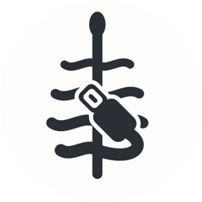
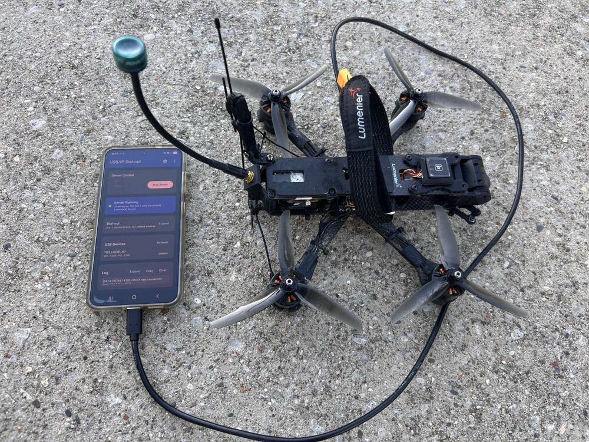
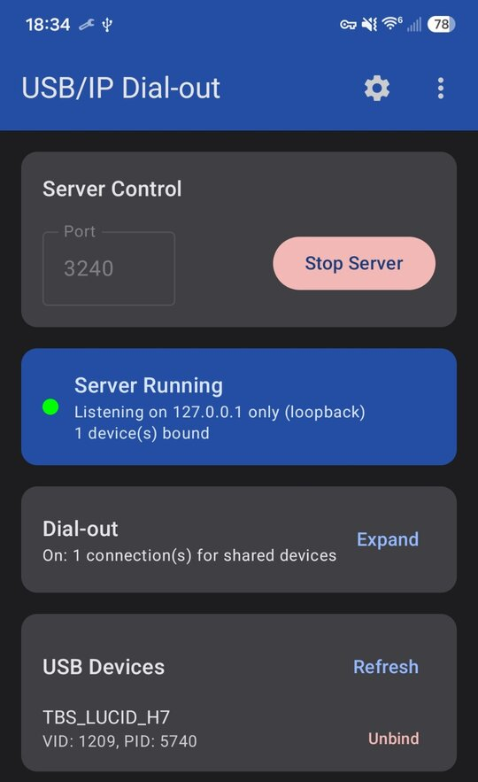
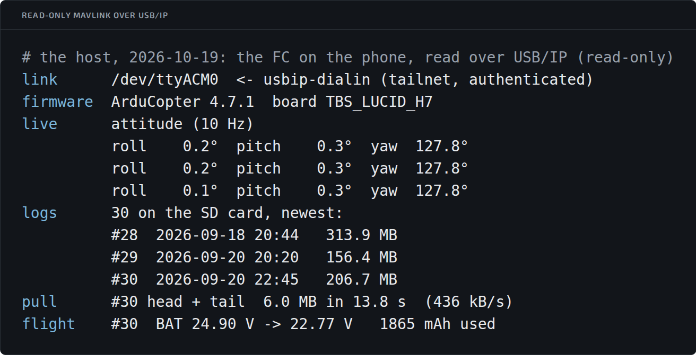

# Android-Usbipdcpp

[中文](README.zh.md)

## About this fork



This is a fork of [yunsmall/Android-Usbipdcpp](https://github.com/yunsmall/Android-Usbipdcpp),
modified in October 2026 by brackenjoe. The upstream maintainer declined a
dial-out mode as out of scope for a server
([#2](https://github.com/yunsmall/Android-Usbipdcpp/issues/2)) and welcomed a
fork; this fork adds it in the app only. The usbipdcpp library is unchanged.

**Install:** download the APK from
[Releases](https://github.com/brackenjoe/Android-Usbipdcpp/releases) and
open it on the phone (Android asks once to allow installs from your browser
or file manager). Releases are signed with one key, so each installs over
the last. A release does not install over a Build Check build: uninstall
that first, then type the key in again. The host side is set up as in
[`linux/usbip-dialin/README.md`](linux/usbip-dialin/README.md), "Install".

What the fork adds:

- **Dial-out.** The app connects out to a host you name (host and port) and
  forwards bytes between that connection and its own USB/IP server on
  `127.0.0.1`, one connection per shared device. Use it when the host
  cannot connect to the phone (behind NAT, on mobile data) or must not
  (policy), for example over a Tailscale network. It dials only over a VPN
  (any app that Android reports as a VPN): with no VPN up, it does not
  dial. It redials 1 s after a connection that authenticated and reached
  the local server, and backs off from 1 s to 30 s after any other; while
  it waits for a fingerprint it checks again every 5 s.
- **Authentication, both ways, before any USB/IP byte**, with a 32-byte key
  shared with the host (the protocol is in
  [`linux/usbip-dialin/README.md`](linux/usbip-dialin/README.md),
  "Authentication"). The key is typed in once and kept in the Android
  Keystore (StrongBox where the phone has it). It works only for 1 hour
  after a fingerprint, and only while the phone is unlocked; enrolling a
  new fingerprint invalidates it. The app opens behind a fingerprint
  prompt. When the hour is over, connections already up stay up; new ones
  wait for the next fingerprint, and a notification says so. With no key,
  the app does not dial. The key needs Android 11 or later, so dial-out
  does not work on Android 9 or 10. The app does not encrypt the
  connection: that is the VPN's job.
- **Loopback-only listening**, on by default: the server binds `127.0.0.1`,
  so other devices on the same network cannot reach it. The server accepts
  only the app's own dial-out connections from the phone itself, so
  `adb forward` and other local clients on the phone are refused, with
  loopback-only on or off.
- **No camera or microphone.** The CAMERA permission and the UVC camera
  path are removed, so a video-class device cannot be shared; RECORD_AUDIO
  is never requested. CI (Build Check) checks the APK's permissions
  against a list.
- **App data kept on the phone:** excluded from backups and from
  device-to-device transfer.
- A partial wake lock whenever dial-out is active, including while it is
  retrying or waiting for a fingerprint: from the first shared device until
  dial-out is turned off, the server stops or nothing is shared.
- Its own application ID, `io.github.brackenjoe.usbipdcpp`, so it installs
  alongside the original app.

**No prompt on plug-in.** With the default settings, plugging a device in
opens nothing: share it by tapping Bind, and Android asks for USB
permission once per plug-in. Upstream's automatic re-binding of devices
you shared before (since v0.0.11) is under Settings, "Auto-bind previously
shared devices", off by default in this fork; updating from an earlier
build turns it off unless you had changed that switch.

The host side is in [`linux/usbip-dialin/`](linux/usbip-dialin/README.md): a
small service that accepts the phone's connection, checks the peer with
`tailscale whois`, authenticates it, runs the standard USB/IP import flow on
that connection and hands the socket to `vhci_hcd`.

Tested on a Galaxy S25 (Android 17), sharing an ArduPilot flight controller
with a Linux 6.8 host over Tailscale. With authentication on (home WiFi):
the controller's 1301 parameters downloaded in about 9 s, and a parameter
written and read back in about 2 s. After a controller reboot or a replug,
once the phone was unlocked and Android's USB permission prompt accepted,
upstream's re-binding (then on by default) shared it again and the app
redialed and authenticated on its own. By design it does not dial while the phone is
locked. With the first build, before
authentication: 12 s for the parameters on mobile data, and the session
stayed up through a 6 minute screen lock and a WiFi to mobile-data
handover. Tested with one device at a time. The phone may show a dead
connection as connected for up to about 2 h (Android's default TCP
keepalive).

### In use

<p>


</p>


A 5 inch quad's flight controller (TBS Lucid H7, ArduCopter 4.7.1) shared
from the phone with dial-out connected. Below, the Linux host on that
connection reading it over MAVLink: live attitude, the SD card's logs,
and the newest log's battery voltage.

Builds: pushes to `main` that change code also build a debug APK in Actions
(Build Check, under Artifacts), for testing. Each of those is signed with a
new throwaway key, so it installs only after the previous build is
uninstalled, which also deletes the key: type it in again. Use Releases
instead.

Licence: GPL-3.0, as upstream. This product uses usbipdcpp
(https://github.com/yunsmall/usbipdcpp), licensed under LGPLv3.

Everything below this section is upstream's README.


📱🔌 An Android USB/IP server application for sharing USB devices over the network, based on [usbipdcpp](https://github.com/yunsmall/usbipdcpp), a dedicated library for developing USB/IP servers.

## ✨ Features

- 🔗 Share USB devices from Android to remote computers
- 📦 Multiple device support
- ⚙️ Configurable server port
- 🌐 Chinese/English UI
- 📋 Real-time log viewer

## 📋 Requirements

| Item | Requirement |
|------|-------------|
| 🤖 Android | 8.1+ (API 28+) |
| 💻 Hardware | USB OTG support |
| 🖥️ Client | USB/IP client (e.g., `usbip` on Linux) |

## 🚀 Usage

```
Android Device                    Remote Computer
    │                                   │
    │  1. 🔌 Connect USB device         │
    │  2. ▶️ Start server               │
    │  3. ✅ Grant USB permission       │
    │  4. 📎 Bind device                │
    │                                   │
    │◀──────── Network ────────────────▶│
    │                                   │
    │                    5. 📋 usbip list -r <ip>
    │                    6. 🔗 usbip attach -r <ip> -b <busid>
```

## 🔨 Build

```bash
# Clone with submodules
git clone --recurse-submodules https://github.com/yunsmall/Android-Usbipdcpp.git

# Or if already cloned, initialize submodules
git submodule update --init --recursive

# Build with Android Studio (NDK required)
```

## 📄 License

[GPL-3.0](LICENSE)
